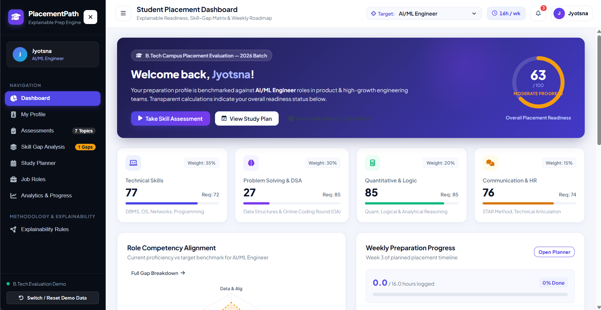
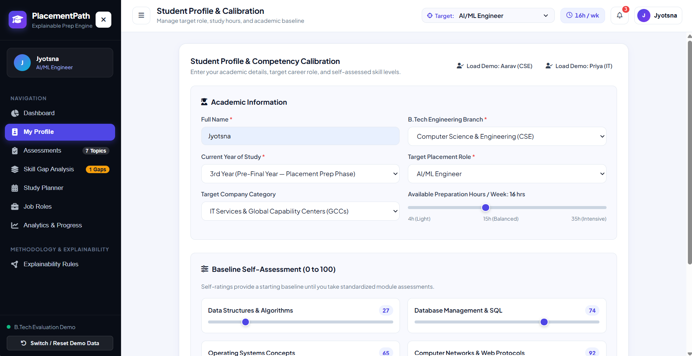
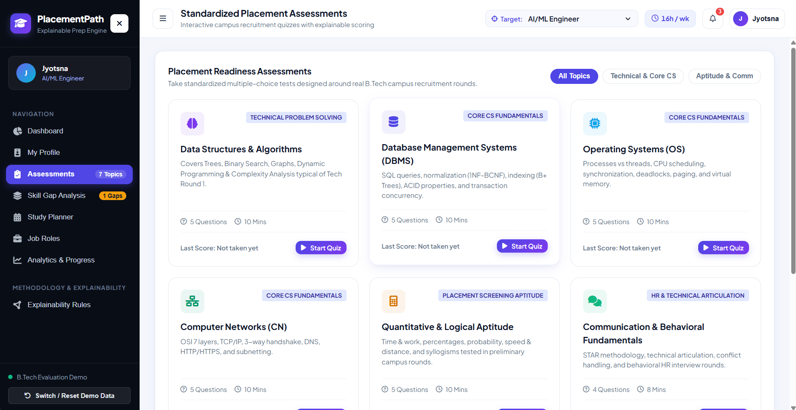
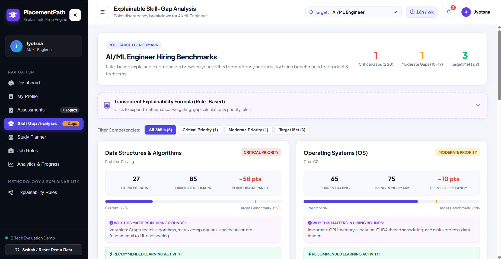
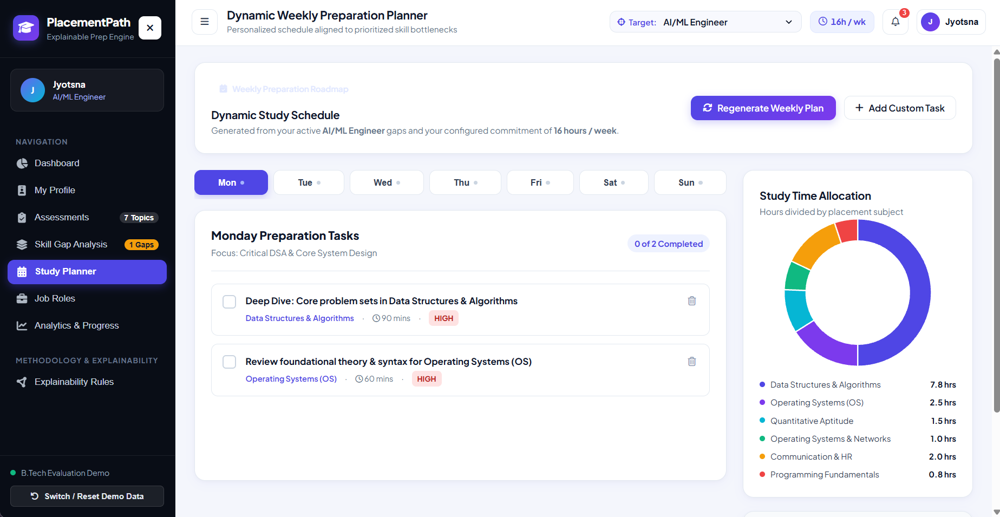
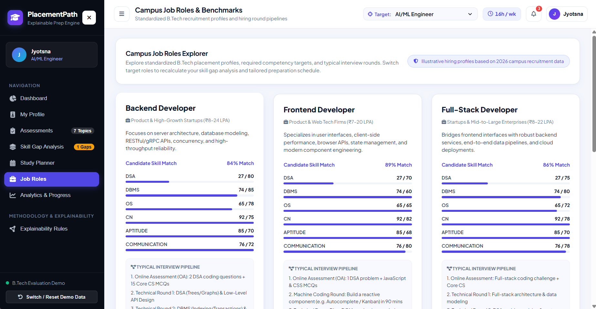
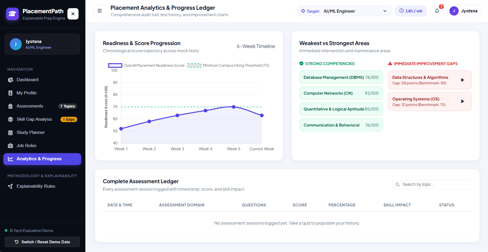
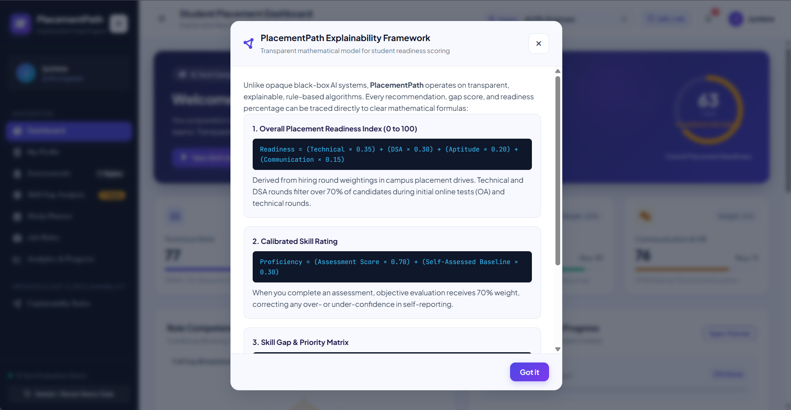

# 🎯 PlacementPath
### Career Readiness & Skill Gap Analysis Platform

  <b>Prepare Today. Get Placed Tomorrow!</b>

---

## 🌐 Live Website

🚀 **[Visit PlacementPath](https://jyotsna2611.github.io/PlacementPath/)**

## 📌 About The Project

PlacementPath is a web application designed to help B.Tech students prepare for campus placements by evaluating their skills and identifying areas for improvement.

It helps students understand their career readiness through skill assessments, skill gap analysis, and personalized learning recommendations.

## ✨ Key Features

- 👨‍🎓 Student Skill Assessment
- 💻 Technical Skill Evaluation
- 🧠 Aptitude Assessment
- 📊 Skill Gap Analysis
- 📚 Personalized Learning Recommendations
- 📈 Performance Tracking Dashboard

## 🛠️ Technologies Used

| Technology | Purpose |
|---|---|
| HTML | Structure |
| CSS | Styling |
| JavaScript | Functionality |
| React.js | User Interface |
| Vite | Development & Build Tool |
| Tailwind CSS | UI Styling |

## 🎯 Project Objective

To help students identify their strengths, improve their weaknesses, and become better prepared for campus placement opportunities.

## 📸 Project Screenshots

### 1. Dashboard

### 2. Student Profile

### 3. Placement Assessments

### 4. Skill Gap Analysis

### 5. Weekly Study Planner

### 6. Campus Job Roles

### 7. Analytics & Progress

### 8. Explainability Rules

## 🚀 Live Demo

[Click Here to Open PlacementPath](https://jyotsna2611.github.io/PlacementPath/)

## 👩‍💻 Developer

**Jyotsna**

---

  ⭐ If you like this project, don't forget to star the repository!

